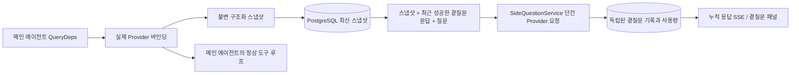

# ARTEX `/btw` side question

Korean · [Chinese](README.zh.md)

General chat, the MainAgent of the task, and the Worker directly launched by the current task each support side questions that are separate from the main conversation. Entering `/btw 질문` in the main input window will submit a side question, and entering `/btw` without any content or pressing the "Side Question" button will open the previous side question record. It is displayed as a sidebar with adjustable width on desktop and as a drawer on mobile.

Side question responses are generated based on a snapshot of the agent context at the time the question is submitted, and support marking, asking additional questions, stopping, and clearing the stream. Model requests are not canceled when you close the panel, refresh the page, or lose the SSE connection. Stop affects only the one side question currently in progress, and Clear cancels the side question and deletes the side question history, but leaves the body context snapshot intact.

> This document is a translation of the original Chinese document (`README.zh.md`) into Korean. The original is preserved so that changes in upstream repositories can be easily compared.

## scope of implementation

Go, norma v0.3.7, Next.js, and existing Markdown · ResizablePanel · Drawer · AlertDialog components are used as is, and the norma source is not modified or new dependencies are added for side questions. The promotion of Planners, Workers inherited from other tasks, and tool-type subtasks are not included in this scope.

- `capture.go` is displayed as a main loop request only in `Options.Deps.CallModel` · `CallModelSync`. The Provider decorator sits inside each individual model, i.e. outside the routing pool, at the next stage of picking a model, so it records which model was actually selected. Compress and digest requests do not overwrite snapshots.
- Snapshots are issued when a request is initiated, when the model completes a response, and when execution reaches the end state. We do not issue half-responses that are in the process of being generated. Tool calls persist through `MessagesForAPI` in norma , and tool results are taken into a snapshot at the next main model request or at the end of execution. If streaming is interrupted, the previous valid boundary is maintained.
- Snapshots are deep copies of JSON, preserving structured messages, system prompts, tool definitions, and creation parameters. Model inference does not hold snapshot locks or database transactions.
- `SideQuestionService` calls an individual Provider. If necessary, we first create a summary of side questions, and the final response is pared down and retried once and only if the context first exceeds the limit and has not yet emitted any text or tool calls. It does not create a new agent session, does not connect to a tool executor, main transcript, activity stream, or task graph, and does not go through a task model transition chain. The response retains the tool definition for compatibility with existing structured tool contexts, and does not provide a tool for summary requests. The newly returned tool call has no execution path.
- There is one request running per parent session, a maximum of four per service process, and a timeout of 120 seconds per request. Side questions use an independent cancellation context under the service lifecycle.
- Side question requests keep a reference to the model configuration and a summary of non-sensitive identifying information, and pull credentials from an existing configuration at the time of the request. If settings are deleted or identification fields such as model, protocol, or address are changed, the main agent will be run first to require the snapshot to be updated. Testing does not change the basic product model.

## Perpetuation and Restoration

`db/schema.sql` automatically creates tables `side_question_sessions` and `side_question_requests`. The front table stores the parent resource, latest snapshot, execution number, version, and cleanup version, and the back table stores questions, cumulative responses, status, model, snapshot time, usage, event sequence number, and page sequence number.

The upper session key uses conversation ID or a combination of task ID, exploration ID, and intent ID. Worker does not use reusable execution slot names.

Snapshots are recorded merged into parent sessions and reflected once every 250 milliseconds, and the database compares `(run_id, version)` to prevent older versions from overwriting newer versions. Save the selected snapshot one more time just before submitting your side question. If the save is successful, it frees the large snapshot in memory; if it fails, it leaves behind a version that has not yet been written. Cumulative responses are logged at most once every 250 milliseconds when streaming events arrive, and are stored immediately in exit status, but retried a limited number of times in the event of a database error.

When the service starts, it marks requests that previously remained in the `running` state as `interrupted`, leaves some responses and usage already stored in the database, and does not automatically rerun the requests. The most recently successfully saved context can be used directly in the next question. If the old session does not have a snapshot, it requires running the main agent first and does not recreate the context from the UI activity history.

The purge operation raises a clean version, discards the request, and prevents conditional updates from logging late-arriving callbacks again. When physically deleting a parent resource, it is left to foreign key cascade, and when logically deleting a Worker, side data is also deleted within the same transaction, and snapshots that arrive later are rejected. When archiving work, we first block new requests, wait for the main flow to stop, cancel side queries, and wait for them to be reflected in the database. The archive format is v3, and is also compatible with v1 and v2 without side question tables.

All records are saved, and up to 20 records are returned per page based on the sequential cursor. When requesting a model, up to 20 sets of the most recent successful questions and answers are sent again, but the amount is limited to the token budget, and older questions and answers are managed as separate rolling summaries. If the body context exceeds the budget, only summarize older parts of the side-question copy, leaving in recent structuring tool calls and their results. The summary, preparation progress, and usage all fit together within the simultaneous launch/cancel/120-second time limit rules for side questions. For more information, see [Context Budget and Open Source Reference (CONTEXT_BUDGET.md)](CONTEXT_BUDGET.md).

## HTTP contract

The following path is written as `{parent}`, and existing authentication and resource verification are followed.

- `/api/conversations/{id}`
- `/api/tasks/{id}/chat`
- `/api/tasks/{id}/intents/{iid}`

The returns and actions for each request are as follows:

- `GET {parent}/side-questions?before={ordinal}` returns `items` sorted in latest order, along with ongoing execution status (`current`), snapshot meta information (`snapshot`), and next cursor (`next_cursor`). If the cursor is 0, it means it is the latest page or there is no next page.
- `POST {parent}/side-questions` receives JSON in `{ "question": "…", "client_request_id": "UUID" }` format. If it is a new request, the request object is returned with 202, and if the ID and question are the same, the existing object is returned with 200.
- `DELETE {parent}/side-questions` cancels and empties the side questions and answers of the current parent session.
- `GET /api/side-questions/{requestID}/events` sends the `snapshot` SSE event, `id` is the incrementing sequence number, and `data` is the accumulated total request object. When emptying occurs, send `cleared`.
- `POST /api/side-questions/{requestID}/cancel` explicitly cancels the request, and the exit status can be read from history or SSE.

Questions can be up to 4000 characters long. If there is no snapshot, model settings have changed, the same parent session is processing, or idempotent IDs collide, 409 is returned. If the overall concurrent execution upper limit is reached, 429 is returned. SSE connections send the accumulated state first every time, so the client is not dependent on previously received text fragments. The frontend merges the response by request ID and sequence number, and discards previous callbacks when changing or emptying the parent session.

## Verification and Reference Materials

Automated checks, use of real models, and known limitations are summarized in [VALIDATION.md](VALIDATION.md).

For the independent request method, refer to [Grok CLI's side-question.ts (fixed commit)](https://github.com/superagent-ai/grok-cli/blob/fb97af83f06dca873281d60168430f06c8de6324/src/utils/side-question.ts), and for execution isolation, refer to [OpenCode (fixed commit)](https://github.com/anomalyco/opencode/tree/b3f1a96c6dd7adeb28b36dd11add1998fc84d67b). ARTEX uses norma's structured messages for context and does not use text concatenation in the front-end log.
