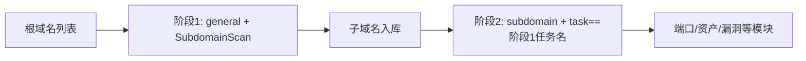

---

## name: scopesentry-mcp
description: Manage the security scanning platform (projects, tasks, templates, assets, nodes) through ScopeSentry MCP. Used when users mention ScopeSentry, MCP, API Key, scanning tasks, and asset queries.

# ScopeSentry MCP User Guide

For users who have deployed a ScopeSentry instance. Connect to the platform via Cursor (or other MCP client), no local source code required.

## 1. Preparation

### 1.1 Confirm that the service is accessible

- Default web interface: `http://<主机>`
- MCP endpoint: `http://<主机>/mcp` (if there is a reverse proxy or front-end proxy in front, the actual `/mcp` address shall prevail)

### 1.2 Create API Key

1. Browser login ScopeSentry web interface
2. Enter the **API Key** management page to create a key (or create it through the interface provided by the administrator)
3. Save the returned `ssk_...` string (**shown only once**)

### 1.3 Configure Cursor MCP

Cursor → Settings → MCP → Add Server:

```json
{
  "mcpServers": {
    "scopesentry": {
      "url": "http://<你的主机>:8082/mcp",
      "headers": {
        "X-API-Key": "<SCOPESENTRY_API_KEY>"
      }
    }
  }
}
```

Also available: `Authorization: Bearer ssk_你的密钥`

After the configuration is completed, restart the MCP or reload the Cursor and confirm that `list_projects`, `list_assets`, etc. appear in the tool list.

---

## 2. Tools Overview


| Tools | Purpose |
| ---------------------- | ----------------- |
| `list_projects` | Project tree grouped by tags (with project ID) |
| `list_projects_data` | Paginated project list, searchable by name |
| `get_project` | Project details |
| `create_project` | New project |
| `list_tasks` | Scanning task list |
| `get_task` | Mission details |
| `list_scan_templates` | Scan template list |
| `get_scan_template` | Template details |
| `list_plugin_modules` | Scanning pipeline module name |
| `list_plugins` | Available plug-ins (including hash, default parameters) |
| `create_scan_template` | Create scan template |
| `create_scan_task` | Create scan task |
| `list_assets` | Query various types of assets (paged list) |
| `count_assets` | Statistical asset quantity (`/api/assets/common/total`) |
| `get_asset_detail` | Asset or vulnerability details |
| `add_asset_tag` | Add tags to assets |
| `list_nodes` | Scan node list |


Each tool parameter is subject to the MCP tool description (schema); the search and filter syntax of `list_assets` / `count_assets` are consistent. You can read the `list_assets` description before querying assets.

When you need to know "how many items in total", use `count_assets` (corresponding to the Web paging total interface). There is no need to repeatedly turn the page `list_assets` to count the total number.

---

## 3. Common workflows

### 3.1 Check assets by project

When the user or context **has project conditions**, bring `filter.project` first to narrow the scope to avoid slow response caused by too much cross-project data. If there are no clear projects, it is not mandatory to add project screening.

1. `list_projects` or `list_projects_data` Get the **ObjectID** of the target item (`id` / `children[].value`)
2. `list_assets` Input `filter.project` (**Must be ID, cannot write the Chinese name of the project**)

```json
{
  "asset_type": "asset",
  "pageIndex": 1,
  "pageSize": 20,
  "search": "domain=^example.com",
  "filter": {
    "project": ["<项目ObjectID>"]
  }
}
```

### 3.2 Create scan tasks

1. `list_nodes` Get the online node name
2. `list_scan_templates` or `create_scan_template` Get template **ObjectID**
3. `create_scan_task`: Required for `name` and `node`, fill in the template ID for `template` (template name cannot be filled in)

**Target source `targetSource` (consistent with the web side):**

| targetSource | Description | Required parameters |
| --- | --- | --- |
| `general` | Directly enter the target | `target` |
| `project` | Read target from project | `project` (project ObjectID array) |
| `asset` | Search from Web Asset Library | `search`; Optional `project`, `filter`, `targetNumber` |
| `RootDomain` | Search from the root domain name database | `search`; optional `project`, `filter`, `targetNumber` |
| `subdomain` | Search from subdomain database | `search`; optional `project`, `filter`, `targetNumber` |
| `UrlScan` | Search from URL scan results | `search`; optional `project`, `filter`, `targetNumber` |
| `*Source` (such as `subdomainSource`) | Created from "Select/Search" on the asset page | Use `search` for `targetTp=search`; use `targetIds` for `targetTp=select` |

**Example—Scan the root domain name directly:**

```json
{
  "name": "example-子域名收集",
  "node": ["node-1"],
  "template": "<模板ObjectID>",
  "targetSource": "general",
  "target": "example.com\nfoo.com",
  "project": ["<项目ObjectID>"]
}
```

**Example - Continue scanning from the subdomain name database (filter by previous task name):**

```json
{
  "name": "example-端口与漏洞",
  "node": ["node-1"],
  "template": "<后续模块模板ObjectID>",
  "targetSource": "subdomain",
  "search": "task==\"example-子域名收集\"",
  "project": ["<项目ObjectID>"]
}
```

### 3.3 Complete information collection of root domain names (two stages recommended)

When the input is **root domain name** and **complete information collection** is to be performed, it is recommended to scan in two times instead of running the entire pipeline at once.

**Cause:** Distributed tasks are distributed in units of **single targets**. When the root domain name is used as the target, after a node is assigned the root domain name, the subdomain names swept out on the node will continue to execute subsequent modules on the node, which can easily cause uneven load, slow speed, and error-prone.

**Best Practices:**

1. **Phase 1 - Subdomain collection only**
   - `targetSource`: `general`
   - `target`: All root domain names (multiple lines)
   - Template: Only enable `SubdomainScan`, `SubdomainSecurity` (subdomain name scanning + subdomain name takeover)
   - Use `get_task` to wait for the task to complete

2. **Phase 2 – Subsequent Modules**
   - `targetSource`: `subdomain`
   - `search`: `task=="<第一阶段任务名称>"` (exactly matches the task name)
   - Optional `project` Narrow range
   - Template: port scanning, asset mapping, vulnerability scanning, etc. (can not include SubdomainScan)
   - The subdomain name is distributed to each node as an independent target, and the parallel efficiency is higher

You can also use "Create Task from Subdomain Name" after filtering by task name on the "Subdomain Name" asset page of the web interface, with the same effect.



### 3.4 Create scanning template

1. `list_plugin_modules` → module name list
2. `list_plugins` (can be filtered by `module`) → each plug-in `hash` and the default `parameter`
3. `create_scan_template`: Use `modules` to specify "module → plug-in hash array"

---

## 4. Asset query (`list_assets` / `count_assets`)

`count_assets` and `list_assets` use the same `asset_type`, `search`, and `filter`, and return `{ "total": N }`, which corresponds to `/api/assets/common/total` on the Web side.

```json
{
  "asset_type": "subdomain",
  "search": "task==\"某任务名\"",
  "filter": {"project": ["<项目ObjectID>"]}
}
```

**Performance recommendations (common to `list_assets` / `count_assets`):** When there are project conditions, give priority to using `filter.project` to narrow the scope; in `search`, try to use `==` congruent or `^` prefix matching (see [4.3](#43-search-search-expression)) for the established index fields to avoid large areas `=` Fuzzy query slows down response. Project filtering is not forced when there is no project context.

The types supported by `filter.project` are shown in [4.4](#44-filter-precise-filtering) table.

### 4.1 Asset type `asset_type`

`asset`、`RootDomain`、`subdomain`、`app`、`mp`、`UrlScan`、`SensitiveResult`、`DirScanResult`、`crawler`、`vulnerability`、`PageMonitoring`、`IPAsset`、`SubdomainTakerResult`

Examples of aliases: `web`→asset, `vuln`→vulnerability, `ip`→IPAsset, `url`→UrlScan

### 4.2 Parameter description


| Parameters | Description |
| ------------------------ | --------------------------------------- |
| `pageIndex` / `pageSize` | Paging, default 1 / 20 |
| `search` | Search expression (see next section) |
| `filter` | Precisely filter JSON (see next section) |
| `sort` | Only UrlScan and DirScanResult support sorting by `length` |
| `sid` | SensitiveResult only: Sensitive rule name |


`search` and `filter` **can be used simultaneously**.

### 4.3 search search expression

Custom DSL (**not SQL**):


| Operator | Meaning | Index | Example |
| ---- | ---- | ---- | --------------------------- |
| `=` | Fuzzy matching (regex) | No indexing | `domain=example` |
| `==` | Exact match (congruent) | **Go index** | `port==443` |
| `!=` | Exclusion | — | `port!="80"` |
| `&&` | with | — | `domain==example.com && port==443` |
| `||` | or | — | `title=admin || body=login` |


**Indexes and operators:** `domain`, `ip`, `port`, `title` and other fields are indexed, but only **`==` congruent** or **values starting with `^` prefix match** (such as `domain=^example.com`) can be indexed; **`=` will be converted to regex fuzzy matching, and the index cannot be used**, and it may become slow when the amount of data is large.

**Search field common to all types:** `tag`, `task` (task name), `rootDomain`

**project cannot be written in search** (invalid or an error will be reported when combined with `&&`). Please use `filter.project` for sieve items.

**Commonly used search fields of various types:**


| asset_type | field |
| -------------------- | ----------------------------------------------------------------------------------- |
| asset                | domain, ip, port, service, app, title, statuscode, icon, banner, type, body, header |
| RootDomain           | domain, icp, company                                                                |
| subdomain            | domain, ip, type, value                                                             |
| app                  | name, icp, company, category, description, url, apk                                 |
| mp                   | name, icp, company, category, description, url                                      |
| UrlScan              | url, input, source, resultId, type                                                  |
| SensitiveResult      | url, sname, body, info, md5                                                         |
| DirScanResult        | url, statuscode, redirect, length                                                   |
| vulnerability        | url, vulname, matched, request, response, level                                     |
| crawler              | url, method, body, resultId                                                         |
| PageMonitoring       | url, hash, diff, response                                                           |
| IPAsset              | ip, domain, port, service, webServer, app                                           |
| SubdomainTakerResult | domain, value, type, response                                                       |


**search example:**

- `domain==www.example.com && port==443` (congruent, indexed)
- `domain=^example.com` (prefix matching, indexing)
- `ip==192.168.1.1`
- `task=="某任务名"`
- `level==high`（vulnerability）
- `statuscode==200`（DirScanResult）

When fuzzy inclusion is required, use `=`, such as `title=admin` (without indexing, it is advisable to narrow the scope in accordance with project and other conditions).

### 4.4 filter precise filtering

JSON object: Multiple values ​​with the same key are **OR**, and different keys are **AND**.

**`project` is used first when there are project conditions:** If the user or context has specified the project, and the asset_type supports `project`, it should be brought to narrow the scope; it is not mandatory when there is no project information.


| filter key | meaning | value description |
| ------------ | -------- | -------------------------------------------------------- |
| `project` | Project | **ObjectID**, obtained with `list_projects` / `list_projects_data` |
| `task` | Source Task | **Task Name**, `name` using `list_tasks` |
| `port` | Port | Such as `"443"` |
| `service` | Service/Agreement | Such as `"https"` |
| `app` | Application fingerprint | Such as `"Nginx"` |
| `icon` | Icon hash | |
| `statuscode` | HTTP status code | Mainly used for asset |
| `status` | Status | UrlScan/DirScan HTTP code; vulnerability/sensitive information processing status |
| `level` | Vulnerability level | critical / high / medium / low / info |
| `type` | Type | Such as subdomain name record type A, CNAME |
| `color` | Sensitive rule color | SensitiveResult |
| `sname` | Sensitive rule name | SensitiveResult |
| `tags` | Tags | |


**Filter key available for each type:**


| asset_type                            | filter key                                                      |
| ------------------------------------- | --------------------------------------------------------------- |
| asset                                 | project, port, service, app, icon, statuscode, type, task, tags |
| RootDomain                            | project, tags                                                   |
| subdomain                             | project, type, task, tags                                       |
| app / mp                              | project, tags                                                   |
| UrlScan                               | status, tags                                                    |
| DirScanResult                         | status, tags                                                    |
| SensitiveResult                       | status, color, sname, tags                                      |
| crawler                               | project, task, tags                                             |
| vulnerability                         | project, level, status, task, tags                              |
| PageMonitoring / SubdomainTakerResult | tags                                                            |
| IPAsset                               | project, port, service, app                                     |


**filter example:**

```json
{"project": ["<项目ObjectID>"], "port": ["443"]}
```

**Combined query example:**

```json
{
  "asset_type": "asset",
  "search": "domain=^baidu && port==443",
  "filter": {"project": ["<项目ObjectID>"]},
  "pageIndex": 1,
  "pageSize": 10
}
```

**Notice:**

- When there are project conditions, `filter.project` will be given priority (when supported); it is not mandatory if there is no project context.
- `filter.project` Do not fill in the item display name
- Use `==` for known values ​​and `^` for prefixes; avoid abusing `=` fuzzy matching for large tables
- UrlScan's HTTP status uses `filter.status`; DirScanResult can use `statuscode==200` in search
- SensitiveResult According to the rule name: `search` uses `sname=规则名`, or `filter.sname`

### 4.5 Sort sort

Only **UrlScan**, **DirScanResult** support:

```json
{"length": "ascending"}
```

Other types ignore `sort` and sort by time by default.

---

## 5. Scan template module name

`TargetHandler`、`SubdomainScan`、`SubdomainSecurity`、`PortScanPreparation`、`PortScan`、`PortFingerprint`、`AssetMapping`、`AssetHandle`、`URLScan`、`WebCrawler`、`URLSecurity`、`DirScan`、`VulnerabilityScan`、`PassiveScan`

---

## 6. Troubleshooting


| Phenomenon | Treatment |
| --------- | -------------------------------------------------- |
| MCP without tools | Check if URL, API Key, ScopeSentry is running |
| 401 / 403 | Recreate or replace API Key |
| Asset cannot be found | Confirm `filter.project` is ObjectID; do not write project in search |
| Template/task creation failed | `template` must be the template ObjectID; `node` fills in the online node name |
| Query is very slow/stuck | Add `filter.project` when there are items; search uses `==` or `^` prefix for indexed fields, use less `=`; reduce `pageSize` |


---

